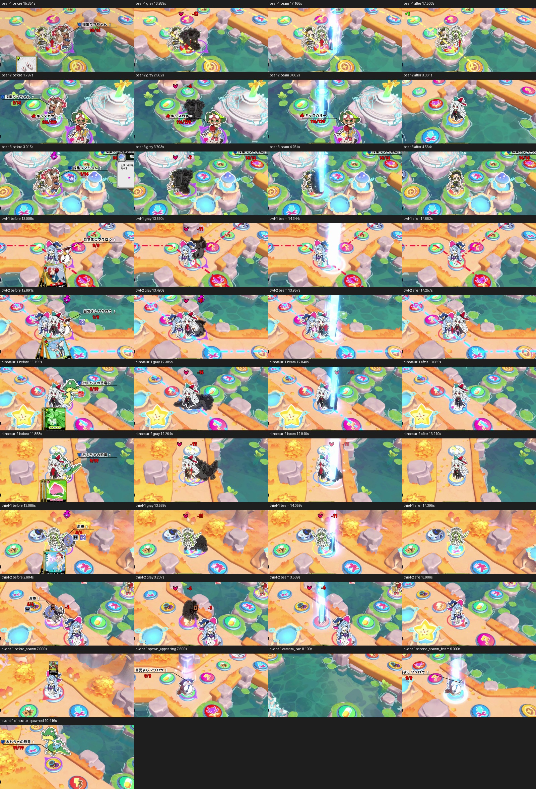

# 秋幻の森・撃破演出の確認用素材（2026-10-19）

利用者提供「秋幻.zip」の10本を確認。保存した短い動画は名前欄などを避けた原寸1600×760・音声なし。キャラとの重なりを残している。ボス撃破は未提供で、全身が映ることを判定条件にしない。難易度設定・ゲーム内再生倍率は未確定。

| 動画 | 対象 | 映像で確認した番号 | 元動画内の保存区間（秒） | 特徴 |
| --- | --- | --- | --- | --- |
| [bear-1](videos/bear-1.mp4) | 採集クマちゃん | 1 | 15.8–17.7 | 複数キャラとの重なり |
| [bear-2](videos/bear-2.mp4) | 採集クマちゃん | 2 | 1.6–3.6 | カード攻撃、ボスHPラベル、カメラ移動 |
| [bear-3](videos/bear-3.mp4) | 採集クマちゃん | 3 | 2.9–5.0 | 同じマスのキャラとの重なり |
| [owl-1](videos/owl-1.mp4) | 目覚ましフクロウ | 1 | 12.9–15.0 | 手前のキャラが左側を隠す |
| [owl-2](videos/owl-2.mp4) | 目覚ましフクロウ | 3 | 12.65–15.0 | 2人の後ろ、頭・右側だけが見える例 |
| [dinosaur-1](videos/dinosaur-1.mp4) | おもちゃの恐竜 | 2 | 11.65–14.3 | 胴が隠れたまま尻尾・横倒しの動き |
| [dinosaur-2](videos/dinosaur-2.mp4) | おもちゃの恐竜 | 1 | 11.75–13.35 | グレーの立ち姿から横倒し |
| [thief-1](videos/thief-1.mp4) | 泥棒 | 1 | 13.0–15.2 | キャラの後ろで袋・体が傾く |
| [thief-2](videos/thief-2.mp4) | 泥棒 | 2 | 2.3–4.4 | カード攻撃と消滅の光、カメラ移動 |
| [event-1](videos/event-1.mp4) | 出現イベント（非撃破） | 複数 | 6.9–10.8 | 出現の光柱、カメラ移動での範囲外を誤認しない |

時間は提出動画のもの。フレーム番号は0始まり。可変フレーム間隔なので、整数fpsでフレーム番号を逆算しない。正確な入力フレーム番号・PTSと保存動画の時刻は [manifest.json](manifest.json) を参照。

- `review-specs.json`：人が映像で確認した対象・番号・遮蔽、抽出時刻。
- `manifest.json`：入力ZIP／元動画のSHA256、切り抜き座標、全保存フレームの元時刻対応、映像／静止画のハッシュ。`before / gray / beam / after` は選んだ画面のラベルで、演出開始・終了の厳密な境界や検出器の出力ではない。
- `frames/`：元動画から直接抽出した41画面（可逆WebP、元RGBのハッシュ付き）。動画はH.264確認用再圧縮なので、画素単位の比較にはこちらを使う。
- `text-reader-baseline.json`：現行の文字読取へ41画面を通したNative Canvasでの結果。撃破認識を新規実装した結果ではない。

生成：`python3 scripts/build-autumn-defeat-samples.py --source ZIP`。検証：同スクリプトに `--check`。詳細・未実装範囲・次の方針は [開発記録](../../../../../docs/screen-reader-defeat-samples.md)。
